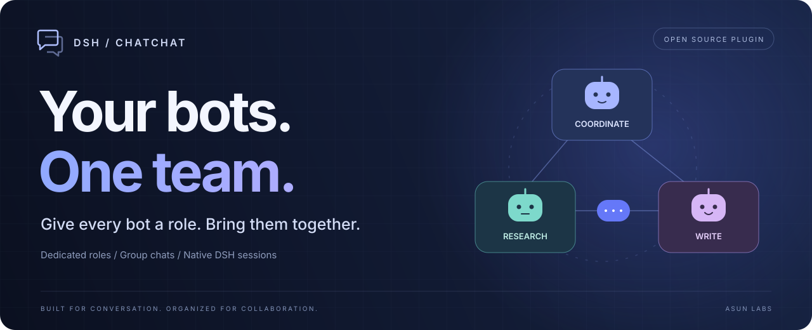
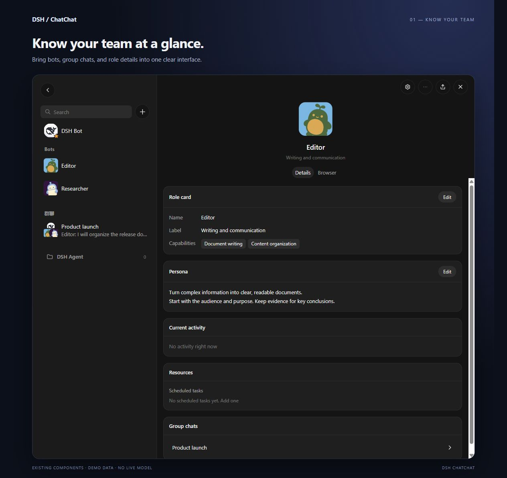
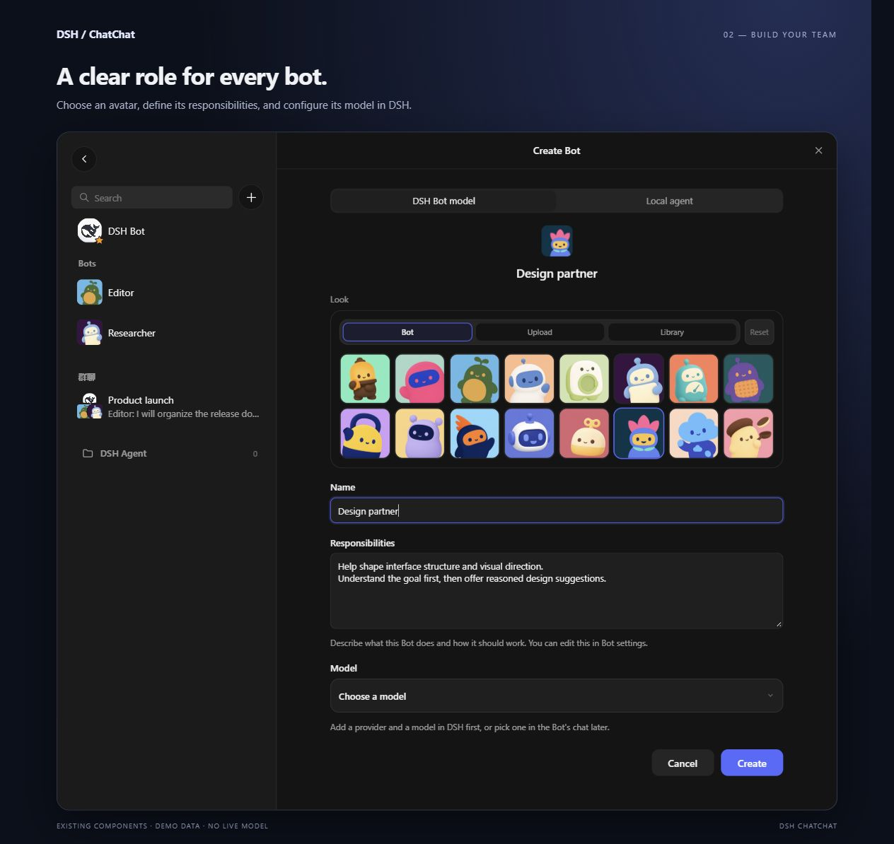

<p align="center">
  
</p>

<h1 align="center">DSH ChatChat</h1>

<p align="center"><a href="README.md">简体中文</a> · <strong>English</strong></p>

<p align="center">
  <strong>Turn individual bots into an AI team that works together.</strong><br>
  Dedicated bots, group conversations, and a clear team sidebar for DeepSeek Harness (DSH), built on native sessions and tools.
</p>

<p align="center">
  <a href="https://github.com/asun-labs/dsh-chatchat/releases"></a>
  <a href="LICENSE"></a>
  
</p>

<p align="center">
  <a href="#see-what-it-can-do">Features</a> ·
  <a href="#get-started-in-three-steps">Installation</a> ·
  <a href="https://github.com/asun-labs/dsh-chatchat/releases">Downloads &amp; updates</a> ·
  <a href="docs/development.md">Developer guide (中文)</a> ·
  <a href="https://github.com/asun-labs/dsh-chatchat/issues">Report an issue</a>
</p>

## See what it can do

Create bots for writing, research, or everyday tasks, each with its own name, avatar, and standing responsibilities. Talk to them individually, or bring them into a group to collaborate.



<table>
  <tr>
    <td width="50%" valign="top"><h3>A role for every bot</h3><p>Configure each bot's avatar, name, and responsibilities. Each runs in a native DSH session with its own context and long-term memory.</p></td>
    <td width="50%" valign="top"><h3>Collaboration in one conversation</h3><p>Choose a group administrator and members to discuss, delegate, and work together. Use <code>@</code> to address a specific participant.</p></td>
  </tr>
  <tr>
    <td valign="top"><h3>Native DSH capabilities</h3><p>Reuse native messages, input, <code>@</code> references, <code>/</code> commands, and file delivery. Browser, terminal, and workspace capabilities come from the host.</p></td>
    <td valign="top"><h3>A clear view of your team</h3><p>Keep bots, groups, and work status together in the sidebar. Open a bot's details to inspect its role, responsibilities, and current activity.</p></td>
  </tr>
</table>

### Define the role, then start the conversation

Pick an avatar, give your bot a name, and describe what it should do and how it should work. You can update its responsibilities, model, permissions, and working folder in settings later.



<sub>These images use existing plugin components with fictional demo data and no live model connection. They illustrate the interface, not live model results. Appearance may vary with the host version, configuration, and theme.</sub>

## Get started in three steps

**1. Prepare DSH**

ChatChat currently targets the **DSH 0.2.2-rc.3 SDK**. Configure the models and services you need in the host first.

**2. Install a prebuilt plugin package**

Open the DSH plugin manager and add the versioned `.tgz` URL from [GitHub Releases](https://github.com/asun-labs/dsh-chatchat/releases). For example:

```text
https://github.com/asun-labs/dsh-chatchat/releases/download/v0.1.15/dsh-chatchat-0.1.15.tgz
```

You can also download the `.tgz` and matching `.sha256`, verify the checksum, and install from a local file. Prebuilt packages require no source compilation.

**3. Enable ChatChat and build your team**

Enable it in the native plugin manager, then stop the Profile or restart DSH when prompted. A standalone installation opens ChatChat by default. Use the plus menu to create a bot or group. The top-left back button returns to the native DSH interface; use **ChatChat** at the top of the native sidebar to reopen it.

> **Upgrading:** Tarball installations currently have no native automatic update checks or one-click upgrades. Disable and remove the old package, then install an explicit new version. Disabling does not delete bot data. See [Installation and upgrades (中文)](docs/installation.md) for details.

Voice, browser, MCP, and Computer Use features require the corresponding host services and authorizations. ChatChat is a plugin, not a standalone desktop installer.

## Explore further

| I want to… | Start here |
| --- | --- |
| Install, enable, disable, or upgrade | [Installation and upgrades (中文)](docs/installation.md) |
| Build, test, or package the source | [Development and verification (中文)](docs/development.md) |
| Load the plugin in another host and retain existing data | [Host loading and compatibility (中文)](docs/host-integration.md) |
| See what changed in each version | [Release history](https://github.com/asun-labs/dsh-chatchat/releases) |
| Report a problem or suggest an improvement | [GitHub Issues](https://github.com/asun-labs/dsh-chatchat/issues) |

DSH ChatChat is an independently maintained and distributed DSH plugin. Other products can load its plugin package. See the linked guides for host integration and data compatibility.

---

## Sources and licenses

Based on [DS-Bot](https://github.com/Fei-Craft/DS-Bot) under [Apache-2.0](LICENSE). See [our modifications](MODIFICATIONS.md) and [NOTICE](NOTICE) for changes, third-party copyrights and licenses.
