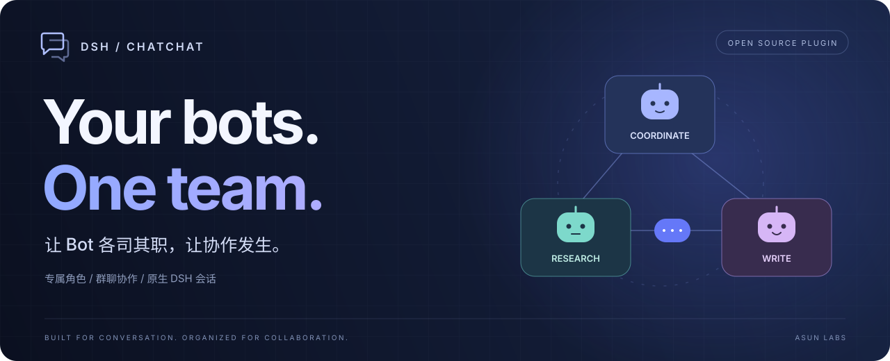
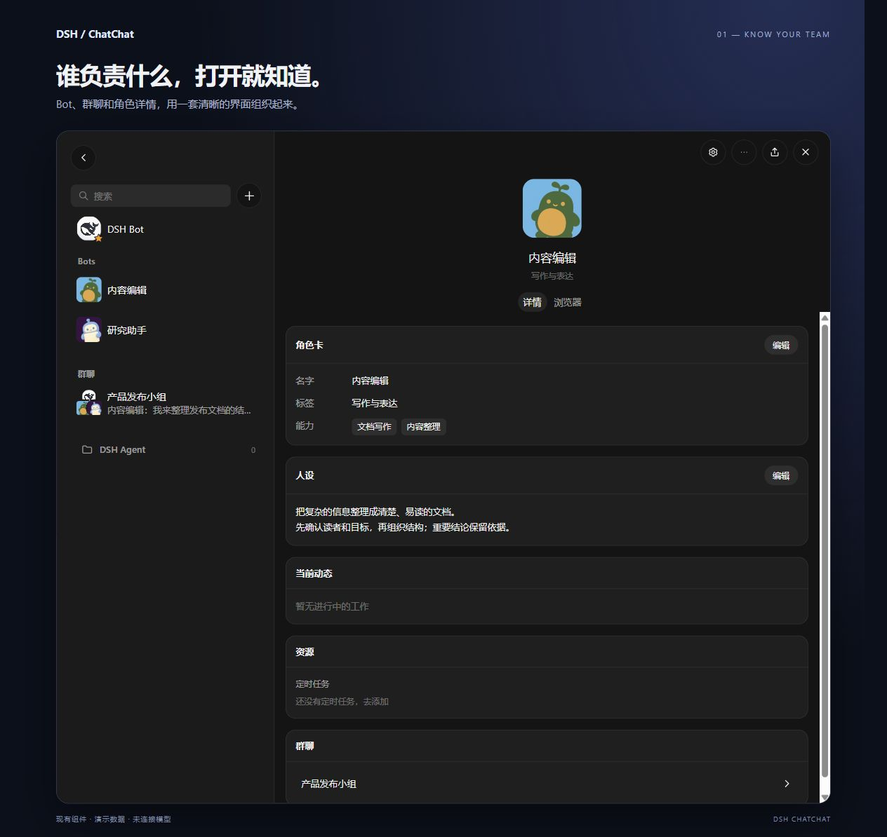
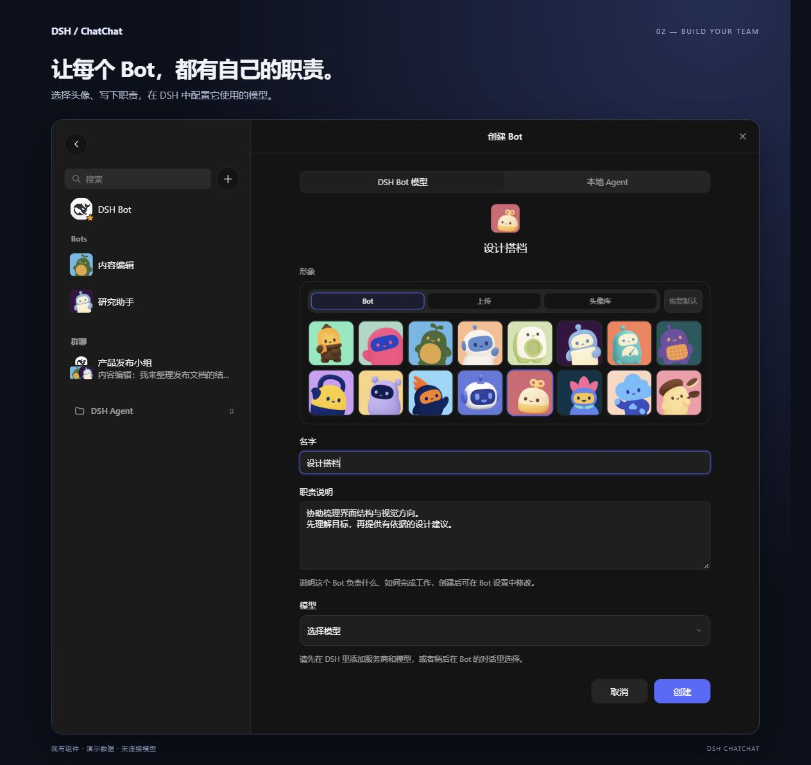

<p align="center">
  
</p>

<h1 align="center">DSH ChatChat</h1>

<p align="center"><strong>简体中文</strong> · <a href="README.en.md">English</a></p>

<p align="center">
  <strong>把独立的 Bot，组织成一起工作的 AI 团队。</strong><br>
  为 DSH 带来专属 Bot、多人群聊与清晰的团队侧栏，沿用原生会话与工作能力。
</p>

<p align="center">
  <a href="https://github.com/asun-labs/dsh-chatchat/releases"></a>
  <a href="LICENSE"></a>
  
</p>

<p align="center">
  <a href="#先看看它能做什么">功能展示</a> ·
  <a href="#三步开始">安装使用</a> ·
  <a href="https://github.com/asun-labs/dsh-chatchat/releases">下载与更新</a> ·
  <a href="docs/development.md">开发文档</a> ·
  <a href="https://github.com/asun-labs/dsh-chatchat/issues">反馈问题</a>
</p>

## 先看看它能做什么

为写作、研究或日常任务创建不同的 Bot，给它们各自的名字、头像和长期职责。独立对话，或者拉进一个群里协作。



<table>
  <tr>
    <td width="50%" valign="top"><h3>各司其职的 Bot</h3><p>头像、名称和职责分别配置；每个 Bot 使用原生 DSH 会话，保留自己的上下文与长期记忆。</p></td>
    <td width="50%" valign="top"><h3>把协作放进群聊</h3><p>选择管理员和成员，在同一个群里交流、分派与协作。通过 <code>@</code> 指定交流对象。</p></td>
  </tr>
  <tr>
    <td valign="top"><h3>沿用原生工作能力</h3><p>复用 DSH 消息与输入、<code>@</code> 引用、<code>/</code> 命令和文件交付；浏览器、终端与工作区能力由宿主提供。</p></td>
    <td valign="top"><h3>看得见的团队动态</h3><p>侧栏集中展示 Bot、群聊与工作状态；打开 Bot 详情，查看角色、职责与当前动态。</p></td>
  </tr>
</table>

### 先定职责，再开始对话

选择头像、给 Bot 起个名字，写下它应该做什么、怎样做。创建后仍可在设置中调整职责、模型、权限与工作文件夹。



<sub>展示图使用插件现有组件与虚构演示数据，未连接真实模型；用于展示界面，不代表模型实测结果。宿主版本、配置和主题可能影响最终显示。</sub>

## 三步开始

**1. 准备 DSH**

插件当前面向 **DSH 0.2.2-rc.3 SDK**。先在宿主中配置需要使用的模型与服务。

**2. 安装预编译插件包**

打开 DSH 插件管理器，添加 [Releases](https://github.com/asun-labs/dsh-chatchat/releases) 中对应版本的 `.tgz` 下载地址。例如：

```text
https://github.com/asun-labs/dsh-chatchat/releases/download/v0.1.16/dsh-chatchat-0.1.16.tgz
```

也可下载 `.tgz` 与同版本 `.sha256`，核对后从本地文件安装。普通用户安装预编译包即可，无需编译源码。

**3. 启用，创建你的团队**

在原生插件管理器中启用，按原生提示停止 Profile 或重启 DSH。独立安装后默认进入 ChatChat：从加号创建 Bot 或群聊；左上角返回 DSH 原生界面，原生侧栏顶部的 **ChatChat** 入口可再次进入。

> **升级说明：** 当前 tarball 安装不支持原生自动查新或一键升级。先停用并移除旧包，再安装明确的新版本；停用不删除 Bot 数据。完整说明见 [安装与升级](docs/installation.md)。

语音、浏览器、MCP 与 Computer Use 等能力，需要宿主提供相应服务并完成授权。ChatChat 是插件，不是独立桌面安装器。

## 按需继续了解

| 我想了解 | 从这里开始 |
| --- | --- |
| 安装、启停与升级 | [安装与升级](docs/installation.md) |
| 编译源码、运行测试、打包发布 | [开发与验证](docs/development.md) |
| 将插件加载到其他宿主、旧数据兼容 | [宿主加载与兼容](docs/host-integration.md) |
| 每个版本改了什么 | [发布记录](https://github.com/asun-labs/dsh-chatchat/releases) |
| 报告问题或提出建议 | [GitHub Issues](https://github.com/asun-labs/dsh-chatchat/issues) |

DSH ChatChat 是独立维护和发布的 DSH 插件。其他产品可以加载插件包，宿主接入与旧数据兼容的边界见对应文档。

---

## 来源与许可

基于 [DS-Bot](https://github.com/Fei-Craft/DS-Bot)，遵循 [Apache-2.0](LICENSE)。本项目的修改见[修改声明](MODIFICATIONS.md)，第三方版权与许可见 [NOTICE](NOTICE)。
